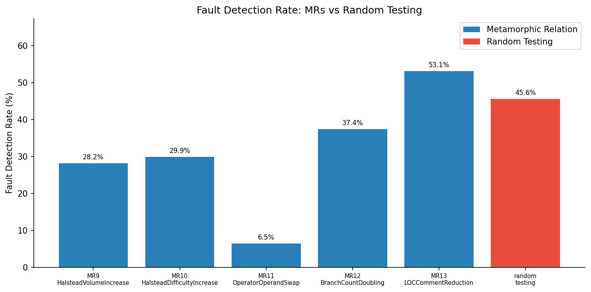
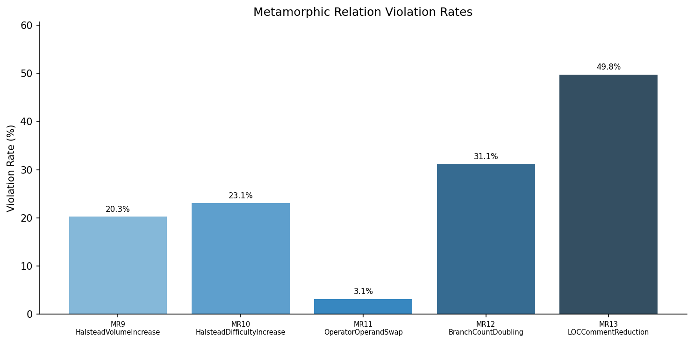
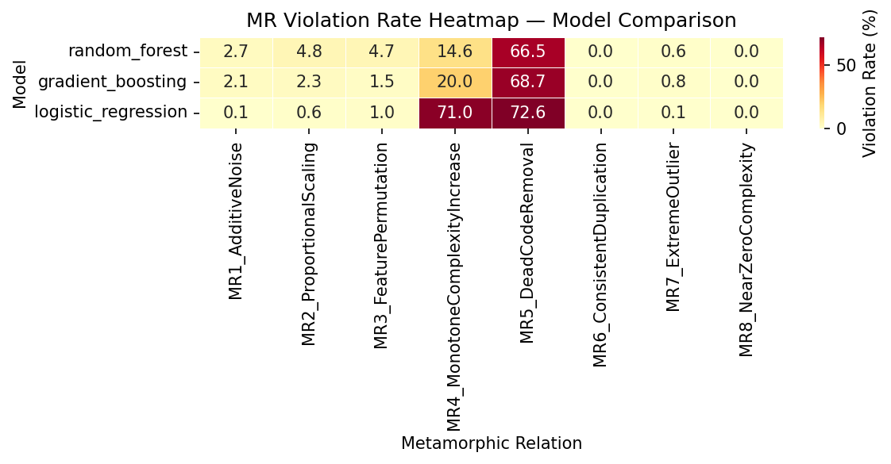
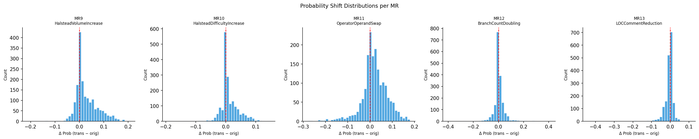

## Overview

Testing Machine Learning classifiers is challenging because of the **oracle problem**—the exact expected output for a transformed input is rarely known in advance. **Metamorphic Testing (MT)** solves this by verifying whether a model satisfies expected input–output properties, called **Metamorphic Relations (MRs)**.

This project builds a complete testing pipeline for **Software Defect Prediction** on the **NASA JM1** dataset that:
1. Trains **Logistic Regression**, **Random Forest**, and **Gradient Boosting** classifiers on static code metrics.
2. Uses **Mistral-7B** (with an offline mock fallback) to automatically generate domain-specific **Metamorphic Relations** and compile them into executable Python tests.
3. Benchmarks **GenAI-synthesized MRs** against **hand-written MRs** and **random testing** across violation rates, probability shifts, execution time, and **Fault Detection Rate (FDR)**.
4. Includes a **Flask web dashboard** (`app.py`) to run tests and inspect visual audit results interactively.

---

## Key Benchmark Results (NASA JM1)

- **Higher Average Fault Detection:** Across 5 LLM-generated relations, GenAI achieved an average FDR of **31.02%**, more than double the **12.38%** average across 8 hand-written rules.
- **Top-Performing Relations:** The best GenAI rule (`MR13_LOCCommentReduction`) reached **53.12% FDR** in `0.58s` (49.78% violation rate), edging out the strongest manual rule (`MR5_DeadCodeRemoval`, **52.87% FDR** in `0.78s`).
- **40× Faster Than Random Testing:** Individual metamorphic relations executed in **0.46s–1.40s**, compared to **45.74s** for random testing (which reached **45.64% FDR**).
- **Strong Complexity-Based Rules:** Other high-performing GenAI relations included `MR12_BranchCountDoubling` (**37.41% FDR**), `MR10_HalsteadDifficultyIncrease` (**29.93% FDR**), and `MR9_HalsteadVolumeIncrease` (**28.18% FDR**).

---

## Visual Results









*(Full CSV breakdowns and runtime plots are saved inside `results/`.)*

---

## Project Layout

- `app.py` & `templates/index.html` — Flask web dashboard for interactive testing and visualization
- `run_experiment.py` & `test_genai_mrs.py` — End-to-end training, execution, and GenAI MR validation scripts
- `data/` — NASA JM1 dataset (`jm1.csv`) and preprocessing loader (`loader.py`)
- `models/` — Model training logic (`trainer.py`) for Logistic Regression, Random Forest, and Gradient Boosting
- `metamorphic/` — Baseline manual relations (`relations.py`) and test runner (`executor.py`)
- `genai/` — Mistral-7B prompt generator (`mr_generator.py`), dynamic compiler (`dynamic_mr_builder.py`), and offline mock responses (`mock_responses.py`)
- `evaluation/` — Metric calculations (`metrics.py`) and plot generation (`visualizer.py`)
- `results/` — Saved benchmark CSVs, JSON audits, and PNG charts

---

## Setup & Usage

1. **Clone the repository and install dependencies:**
   ```bash
   git clone https://github.com
   cd metamorphic-testing-genai
   pip install numpy pandas scikit-learn matplotlib seaborn flask requests python-dotenv
   ```

2. **Add your Hugging Face token (optional for live generation):**
   Create a `.env` file in the root directory:
   ```env
   HF_TOKEN=your_huggingface_token_here
   ```

3. **Run benchmarks or start the dashboard:**
   ```bash
   python run_experiment.py
   python test_genai_mrs.py
   python app.py
   ```
